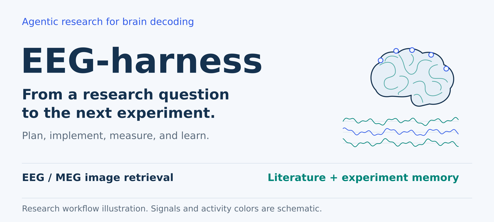
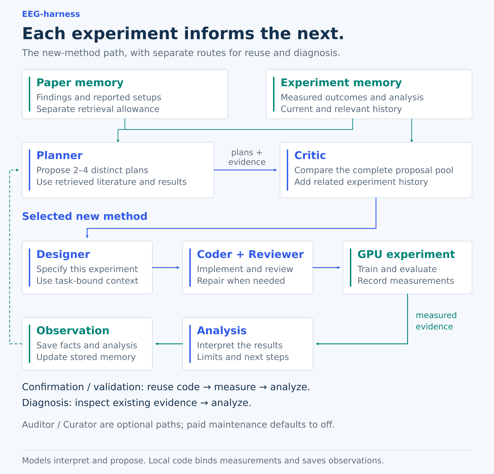
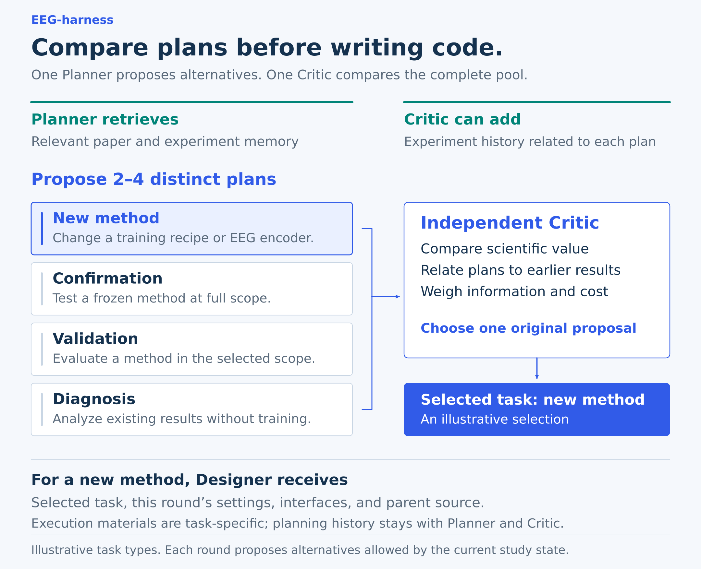

# EEG-harness

**An agent harness for iterative EEG / MEG image-retrieval research.**

Turn a decoding question into a controlled experiment, read the result, and decide what to investigate next. EEG-harness coordinates model-driven planning, design, coding and analysis with local experiment execution, measured evidence and persistent memory.



<p align="center">
  <a href="#the-research-loop">Research loop</a> ·
  <a href="#planning-and-memory">Planning and memory</a> ·
  <a href="#start-here">Start here</a> ·
  <a href="#inside-the-workbench">Workbench</a> ·
  <a href="docs/architecture.md">Source map</a>
</p>

| Research decision | What the harness provides |
| --- | --- |
| **Propose and select** | Multiple proposals, an independent Critic comparison, relevant literature and prior experiment evidence |
| **Design and execute** | A task-specific design, candidate code and review, configurable training, and matched evaluation |
| **Analyze and remember** | Native metrics and diagnostics, an Analyst interpretation, and an Observation available to the next round |

## The research loop

In the current `single_plan_v1` workflow, a Planner proposes **2–4 alternatives** (default: 3). A separate Critic compares the complete pool and selects **one original proposal**. The selected task determines what executes next.



| Selected task | Execution path |
| --- | --- |
| **New method** | Designer → Coder / Implementation Reviewer → training and evaluation → Analysis |
| **Validation** | Reuse an existing implementation → run the requested evaluation → Analysis |
| **Confirmation** | Reuse an existing implementation → collect the specified confirmation evidence → Analysis |
| **Diagnosis** | Inspect existing evidence and collect diagnostics → Analysis |

Each completed task saves an **Observation** connecting its question, method, measured evidence and analysis. This record feeds the next planning round. Extra paid curation and result-audit work are separate maintenance paths; they are off by default for single-plan campaigns.

The campaign goal describes the overall study. Each selected task carries its own evaluation scope, such as two-fold screening or ten-fold confirmation. That scope follows the task through design, execution and analysis. [See the execution and source map.](docs/architecture.md)

## Planning and memory

Planner and Critic make the research decision before implementation begins. Normal proposal and selection use **two model calls**; literature initialization and correction calls are additional. The roles can use the same thinking model with separate prompts.



**Paper memory** stores findings from optional literature retrieval. GPT Researcher provides search and document reading; DeepSeek extracts `topic`, `statement` and `reported_setup`. Sources and provenance are attached locally.

**Experiment memory** stores observations and accepted lessons from the current campaign. Planner retrieves relevant history; Critic can supplement it with proposal-specific experiment matches. Paper findings are reused from the same planning round. Retrieval and matching use local embeddings, with no additional LLM call.

When enabled, the default content allowances are separate:

| Memory content | Default allowance |
| --- | --- |
| Paper findings | Up to 8 retrieved findings within a shared **6000-token** scientific-content budget; initialization reads up to 10 papers |
| Experiment Observations | Up to **6000 tokens per Observation**; selected observations carry detail and other history remains indexed |
| Other historical cards | A separate shared **6000-character** scientific-content budget |

The current task's required feedback is retained separately from optional historical selection. Full records remain on disk. These allowances count scientific content; the complete serialized request still has its own context limit.

Designer and Coder receive the **selected task and implementation materials**: current settings, interfaces, parent code and explicitly supplied artifacts. Historical selection records stay with planning provenance. [Configure memory and inspect its saved records.](react-agent/README.md#memory-across-the-research-loop)

## What an experiment can change

| Component | Supported changes |
| --- | --- |
| EEG / MEG encoder | Convolution, temporal pooling, attention and projection through the candidate encoder hook |
| Training behavior | Train-only transforms, training statistics and custom objectives |
| Training recipe | Per-method `epochs`, `lr`, `batch_size` and `weight_decay` |
| Evaluation scope | Task-bound screening, validation, confirmation or diagnosis under the campaign protocol |

The current retrieval implementation uses **frozen RN50 image features**. Split identities, query/gallery definitions and evaluation metrics belong to the protocol. Image-backbone replacement or fine-tuning, classification, image reconstruction and raw-signal preprocessing are outside the current implementation.

Training supports one or multiple configured GPUs. A loss curve is a training diagnostic; method comparisons use the recorded candidate and control metrics under the declared evaluation scope.

## Start here

Use Python **3.11+** and `uv` for the base project. The optional literature reader requires a **Python 3.12+** agent environment and separate dependencies.

```bash
git clone https://github.com/ZhipengXx/EEG-harness.git
cd EEG-harness/react-agent
uv sync --group dev
cp .env.example .env

PYTHONPATH=src uv run python -m react_agent.fmri.workbench
```

Open [localhost:8765](http://127.0.0.1:8765). The [explicit platform demo](http://127.0.0.1:8765/?demo=1#research/demo_ui_workspace) creates synthetic records without an LLM call or training job.

For real retrieval research, configure the preprocessed data, RN50 feature caches, Torch interpreter, DeepSeek backend and a goal with the study settings and budgets. Explicitly select the current execution protocol:

```bash
PYTHONPATH=src uv run python -m react_agent.eeg_research.agentic.cli create \
  --campaign my_retrieval_study --goal /path/to/goal.yaml \
  --execution-version single_plan_v1 --gpu 0

PYTHONPATH=src uv run python -m react_agent.eeg_research.agentic.cli start \
  --campaign my_retrieval_study

PYTHONPATH=src uv run python -m react_agent.eeg_research.agentic.cli status \
  --campaign my_retrieval_study
```

`create` prepares campaign state and protocol; `start` launches the worker and uses the configured API/GPU budget. `--gpu` accepts comma-separated device indices. Use `pause`, `resume` or `stop` with the same campaign name. [The running guide](docs/running.md) covers prerequisites, goal validation, memory setup and the legacy controller.

## Inside the workbench

Follow a study's decisions, implementation and evidence from one local interface.

| View | Inspect |
| --- | --- |
| **Process** | Role activity, decisions, selected steps and linked evidence |
| **Experiments** | Candidate/control comparisons, evaluation scope and seed coverage |
| **Training curves within Process** | Recorded loss and fixed-gallery Top-1 / Top-5 curves |
| **Code & artifacts** | Candidate source, review summaries and saved research records |

<details>
<summary>Recorded interface preview</summary>


This is an English-localized image of the interface recorded on 2026-10-01, with synthetic DEMO data and the former project name. It is not a screenshot of the current revision. [Browse the platform gallery.](docs/platform.md)

</details>

## fMRI screening

A separate workflow screens an existing predicted fMRI series, or generates one through a configured external TRIBE backend before screening it. Rule-based numeric screening can run offline; optional tools and model planning have their own configuration. Reports retain the `numeric_consistency_only` claim scope.

[Run the offline screening example](docs/running.md#offline-numeric-screening) or [generate from an image](docs/running.md#generate-from-an-image-and-screen-the-prediction). EEG retrieval and fMRI screening keep their protocols, state and memory separate.

## Explore the project

| Resource | Contents |
| --- | --- |
| [Running guide](docs/running.md) | Setup, goals, commands, GPU configuration and study controls |
| [Runtime and memory reference](react-agent/README.md) | Model inputs, memory budgets, saved records and maintenance commands |
| [Architecture and source map](docs/architecture.md) | Task routing, stage responsibilities and implementation links |
| [Research runtime](react-agent/src/react_agent/eeg_research/agentic/) | Planning, execution, analysis, prompts and memory |
| [Training worker](react-agent/src/react_agent/eeg_training/) | Data protocol, candidate hooks, training and evaluation |
| [Figure sources](docs/figures/README.md) | Editable diagrams and reproducible PNG exports |

The diagrams illustrate the software architecture. The archived interface images use synthetic DEMO records.

The conversation entry originated from the [LangGraph ReAct template](https://github.com/langchain-ai/react-agent). Retrieval builds on the Uncertainty-aware Blur Prior workflow; the separate fMRI workflow integrates external TRIBE resources. Optional literature acquisition uses [GPT Researcher](https://github.com/assafelovic/gpt-researcher). See the [license](react-agent/LICENSE).
