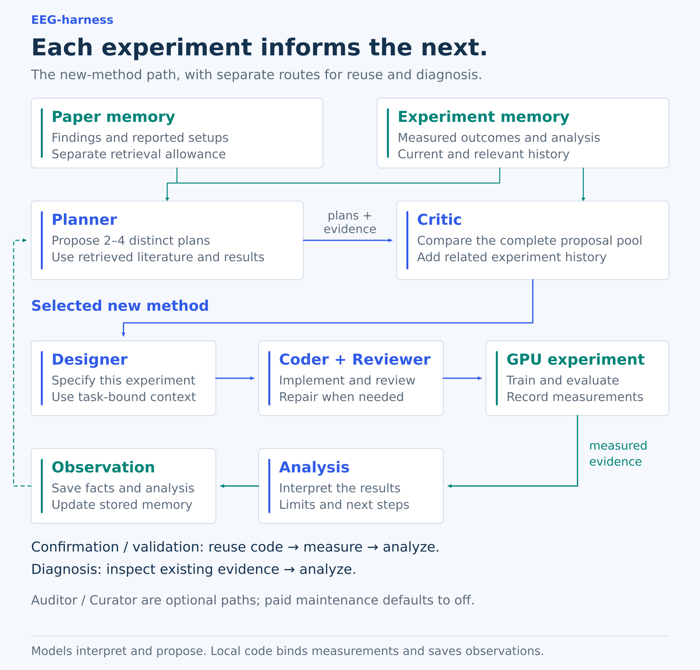

# Architecture and source map

EEG-harness coordinates a research campaign through explicit tasks, candidate implementations, measurements and memory. This page describes the current `single_plan_v1` path and links each responsibility to its source. See [running a campaign](running.md) for commands.

## Research flow

1. **Planner** proposes 2–4 alternatives from the question, current results and retrieved evidence.
2. **Critic** compares the complete pool and selects one original plan. It shares Planner's paper context and can retrieve additional experiment history matched to the proposals.
3. The runtime dispatches the selected task. **New methods** go through Designer → Coder / Reviewer → training. **Validation and confirmation** measure an existing implementation; **diagnosis** runs the requested diagnostics and analyzes their evidence. These branches skip design and coding.
4. **Measurement** binds results to the task and evaluation scope. **Analyst** interprets the measured comparison and diagnostics.
5. Local code records an **ExperimentObservation** containing measured facts, analysis and limitations. The next Planner can retrieve it. Paid Auditor / Curator maintenance is optional and defaults to `off` for single-plan execution.

Normal proposal and selection use two API calls, apart from corrections or retries. Optional paper initialization is separate. Training, deterministic measurement checks, observation assembly and local retrieval are not additional model-review stages.

## Context belongs to the stage

| Stage | Input needed for the task | Main output |
| --- | --- | --- |
| Planner | Research question, current evidence, selected experiment history and paper findings | Alternative tasks with scientific intent and expected observations |
| Critic | Proposal pool, shared planning evidence and proposal-specific experiment matches | Selected proposal and comparison rationale |
| Designer | Selected task, locally resolved current fold setting, parent source/configuration and supported interfaces | Design brief and implementation requirements |
| Coder / Reviewer | Approved design, source and interfaces, current implementation feedback | Candidate implementation and implementation review |
| Analyst | Bound experiment specification, native measured results, aggregate comparison and training diagnostics | Scientific interpretation, limitations and follow-up suggestions |
| Observation assembly | Accepted analysis plus native experiment facts and source identities | Persistent experiment-memory record |

Designer does not receive the general retrieved-history bundle, Critic selection bookkeeping or baseline diagnostic history. Local code embeds the current task's fold scope and completion condition, so downstream stages use the current experiment setting rather than guessing from the overall research goal.

The models supply scientific judgments and code. Local code supplies identities, protocol settings, measured metric values, source bindings and record assembly. Prompt projection keeps internal validation and recovery records out of the scientific input.

## Source map

The links below point to the implementation files in this checkout.

| Responsibility | Implementation |
| --- | --- |
| Campaign control and selected-task dispatch | [`agentic/cli.py`](../react-agent/src/react_agent/eeg_research/agentic/cli.py), [`selected_plan.py`](../react-agent/src/react_agent/eeg_research/agentic/selected_plan.py), [`worker.py`](../react-agent/src/react_agent/eeg_research/agentic/worker.py) |
| Proposal and Critic selection | [`staged_planning.py`](../react-agent/src/react_agent/eeg_research/agentic/staged_planning.py), [`planning_context.py`](../react-agent/src/react_agent/eeg_research/agentic/planning_context.py), [`planning_contract.py`](../react-agent/src/react_agent/eeg_research/agentic/planning_contract.py), [`critic_contract.py`](../react-agent/src/react_agent/eeg_research/agentic/critic_contract.py) |
| Design input and local assembly | [`designer_context.py`](../react-agent/src/react_agent/eeg_research/agentic/designer_context.py), [`designer_contract.py`](../react-agent/src/react_agent/eeg_research/agentic/designer_contract.py) |
| Coding and implementation review | [`coder.py`](../react-agent/src/react_agent/eeg_research/agentic/coder.py), [`coder_context.py`](../react-agent/src/react_agent/eeg_research/agentic/coder_context.py), [`reviewer_context.py`](../react-agent/src/react_agent/eeg_research/agentic/reviewer_context.py), [`reviewer_contract.py`](../react-agent/src/react_agent/eeg_research/agentic/reviewer_contract.py) |
| Experiment binding and measurement | [`run_context.py`](../react-agent/src/react_agent/eeg_research/agentic/run_context.py), [`method_suite.py`](../react-agent/src/react_agent/eeg_research/agentic/method_suite.py), [`comparison.py`](../react-agent/src/react_agent/eeg_research/agentic/comparison.py), [`stage_reviews.py`](../react-agent/src/react_agent/eeg_research/agentic/stage_reviews.py) |
| Training recipe and candidate hooks | [`eeg_training/protocol.py`](../react-agent/src/react_agent/eeg_training/protocol.py), [`hooks.py`](../react-agent/src/react_agent/eeg_training/hooks.py), [`train_entry.py`](../react-agent/src/react_agent/eeg_training/train_entry.py) |
| Analysis inputs and response | [`analysis_context.py`](../react-agent/src/react_agent/eeg_research/agentic/analysis_context.py), [`analysis_contract.py`](../react-agent/src/react_agent/eeg_research/agentic/analysis_contract.py), [`measurement_context.py`](../react-agent/src/react_agent/eeg_research/agentic/measurement_context.py) |
| Experiment observations and retrieval | [`experiment_observations.py`](../react-agent/src/react_agent/eeg_research/agentic/experiment_observations.py), [`semantic_memory.py`](../react-agent/src/react_agent/eeg_research/agentic/semantic_memory.py), [`memory_delivery.py`](../react-agent/src/react_agent/eeg_research/agentic/memory_delivery.py) |
| Paper acquisition, extraction and retrieval | [`literature_sources.py`](../react-agent/src/react_agent/eeg_research/agentic/literature_sources.py), [`literature_bootstrap.py`](../react-agent/src/react_agent/eeg_research/agentic/literature_bootstrap.py), [`literature_contract.py`](../react-agent/src/react_agent/eeg_research/agentic/literature_contract.py), [`literature_memory.py`](../react-agent/src/react_agent/eeg_research/agentic/literature_memory.py) |
| Model routing, requests and recovery | [`role_config.py`](../react-agent/src/react_agent/eeg_research/agentic/role_config.py), [`llm.py`](../react-agent/src/react_agent/eeg_research/agentic/llm.py), [`staged_planning_recovery.py`](../react-agent/src/react_agent/eeg_research/agentic/staged_planning_recovery.py) |
| Optional paid maintenance | [`research_execution.py`](../react-agent/src/react_agent/eeg_research/agentic/research_execution.py), [`loop.py`](../react-agent/src/react_agent/eeg_research/agentic/loop.py), [`audit_context.py`](../react-agent/src/react_agent/eeg_research/agentic/audit_context.py), [`memory.py`](../react-agent/src/react_agent/eeg_research/agentic/memory.py) |

The training recipe can vary learning rate, epochs, batch size and weight decay. The image target still uses precomputed RN50 features; image-backbone replacement or fine-tuning is not part of the current execution interface. Fold selection, gallery and metric definitions remain explicit parts of the evaluation protocol.

## Prompts and role configuration

Current Planner, Critic, Designer, Coder, Reviewer and Analyst prompts live in [`prompts/runtime_v2/`](../react-agent/src/react_agent/eeg_research/agentic/prompts/runtime_v2/). That directory also contains the literature query-planner and reader prompts. [`llm.py`](../react-agent/src/react_agent/eeg_research/agentic/llm.py) selects and assembles the role request.

[`prompts/runtime_v1/`](../react-agent/src/react_agent/eeg_research/agentic/prompts/runtime_v1/) still supplies supporting-role missions and implementation cases; it is not an alternate version of the current stage flow. [`runtime_prompts.py`](../react-agent/src/react_agent/eeg_research/agentic/runtime_prompts.py) selects those targeted hints. The role registry contains nine core roles, including Critic, and two optional literature roles. A role's existence does not mean it runs in every iteration.

## Two memory stores

Paper memory retains extracted findings and their paper sources under `literature_memory/`. Experiment memory retains observations from the current campaign under `experiment_observations/`, with local indexing for retrieval. They use separate content budgets; one does not consume the other's allowance.

Planner receives the current and relevant experiment observations plus selected paper findings. Critic reuses paper findings and can extend the experiment context with matches for each proposed method. Later stage inputs are assembled from the selected task and the stage's own artifacts. The detailed configuration and maintenance commands are in the [runtime README](../react-agent/README.md).

## fMRI screening collaboration

The [workbench](../react-agent/src/react_agent/fmri/workbench.py) provides a shared interface for research and fMRI screening. The workflows retain separate protocols, state and memory.

| Entry | Source and purpose |
| --- | --- |
| fMRI screening | [`fmri/graph.py`](../react-agent/src/react_agent/fmri/graph.py), [`loop.py`](../react-agent/src/react_agent/fmri/loop.py), [`tools/registry.py`](../react-agent/src/react_agent/fmri/tools/registry.py): numeric checks, optional planned diagnostics and scoped reports |
| Optional image-to-response generation | [`fmri/pipeline_graph.py`](../react-agent/src/react_agent/fmri/pipeline_graph.py), [`generation/`](../react-agent/src/react_agent/fmri/generation/): external TRIBE integration |
| ReAct conversation | [`graph.py`](../react-agent/src/react_agent/graph.py): separate conversation entry |
| Studio views | [`langgraph.json`](../react-agent/langgraph.json), [`studio_graph.py`](../react-agent/src/react_agent/eeg_research/agentic/studio_graph.py): the EEG adapter wraps an existing campaign tick as load → step → summarize |

The figures use cool white, navy, blue and cyan to distinguish stage roles, local runtime work and feedback paths. Arrows denote runtime-mediated handoffs; they do not imply that every stage runs for every task. The [platform gallery](platform.md) labels historical DEMO screenshots separately from these conceptual diagrams.

Legacy action planning

Older campaigns can use `planner_mode: compare_options` or `single_action`. Their planner selects a next action directly; they do not use the current two-call proposal / Critic sequence. The compatibility path remains in [`planner.py`](../react-agent/src/react_agent/eeg_research/agentic/planner.py), [`research_plan.py`](../react-agent/src/react_agent/eeg_research/agentic/research_plan.py) and [`loop.py`](../react-agent/src/react_agent/eeg_research/agentic/loop.py). Use `--execution-version single_plan_v1` when creating a new campaign for the flow described above.

